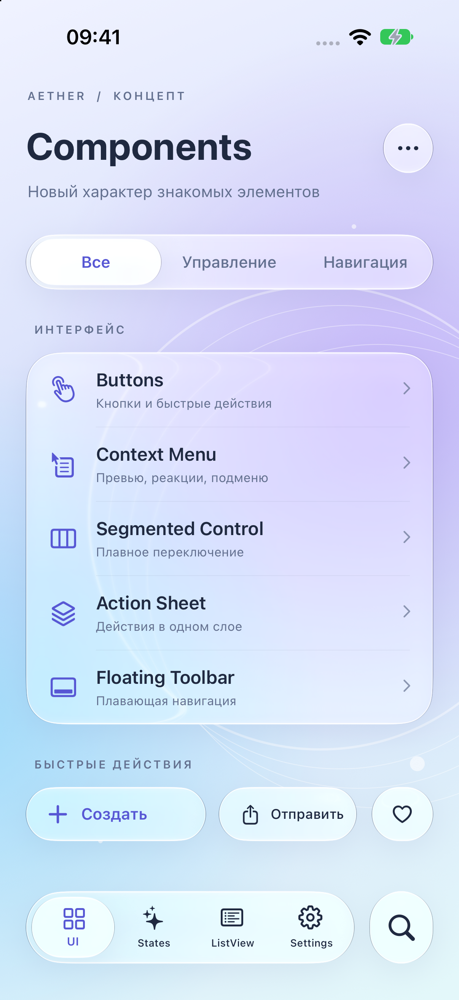
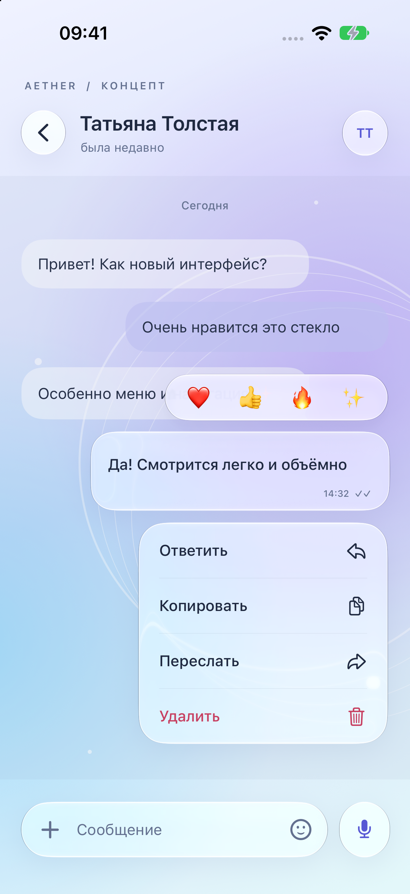
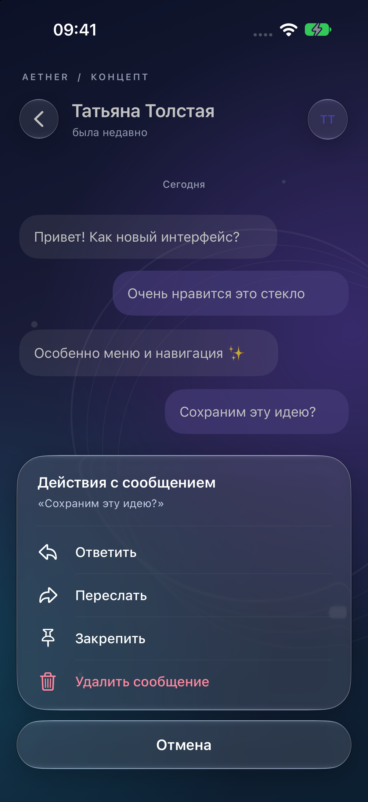
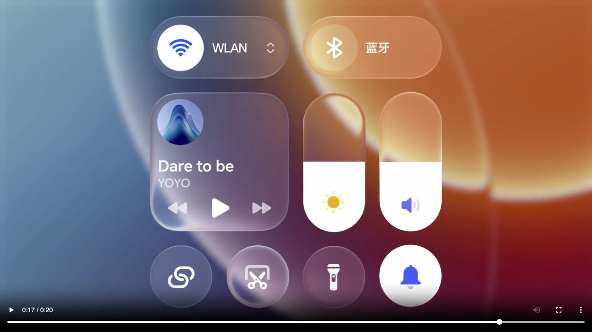

# Стекло MagicOS 11 в AetherUI: аудит реализуемости

Дата: 24 сентября 2026. База: рабочее дерево AetherTextureKit, HEAD `9a6cbfe` **с уже существовавшими незакоммиченными изменениями**, включая ExperimentalGlass. Оценка относится к UIKit/Texture-библиотеке с минимальной iOS 15, а не к переносу оболочки Android целиком.

## Решение

**Воспроизвести узнаваемый внешний вид и большую часть пользовательской механики реально. Точная копия закрытого рендера HONOR на всех поддерживаемых iPhone — отдельная исследовательская задача.** У нас уже есть поверхности, линза, morph-переходы, Texture-интеграция и собственный Metal-шейдер. Основная неопределённость — получение корректного живого фона с приемлемой стоимостью, особенно на iPhone 7.

Рекомендованный путь: общий профиль материала с разной реализацией по возможностям устройства. На iOS 26+ использовать публичное системное стекло, на старых системах — Metal только для проверенных поверхностей и источников, с более простым материалом для тяжёлых сцен. Это сохраняет характер дизайна, но не обещает одинаковые пиксели на разных ОС.

| Объём результата | Сложность | Оценка дополнительной работы |
|---|---|---|
| Интегрированный демонстрационный экран на iOS 26+ | Умеренная | 3–5 человеко-дней |
| Готовое к выпуску оформление ключевых компонентов на iOS 26+ | Средняя | 10–18 человеко-дней, примерно 2–4 рабочие недели |
| Собственный настроенный материал на современных iPhone, контролируемый UIKit-фон | Средняя/высокая | 18–30 человеко-дней, примерно 4–6 рабочих недель |
| Гибрид для iOS 15+: единый характер, собственная оптика на подходящих устройствах, упрощения на слабых | Высокая | 25–40 человеко-дней, примерно 5–8 рабочих недель |
| Собственная близкая оптика и механика на всех ОС, сложный живой фон | Очень высокая, исследовательская | Предварительный резерв 45–70+ человеко-дней; срок уточняется после прототипа захвата |

Это инженерные диапазоны, не измеренные сроки. Предполагаются один опытный UIKit/Metal-разработчик на полный день, доступ к целевым устройствам и периодическое участие дизайнера/QA. Диапазоны альтернативные, их не нужно складывать. Последняя строка не гарантирует паритет на iPhone 7. Системные lock screen, launcher, звонки и ambient-light возможности HONOR целиком в оценку приложения не входят.

## Что подтверждено у MagicOS 11

Официальный релиз HONOR датирован 15 сентября 2026. Основа аудита — актуальная китайская продуктовая страница и демонстрации производителя, а не ранние утечки. HONOR показывает прозрачные элементы с движущимся светом, реакцию панели галереи на освещение, световые реакции на взаимодействие, непрерывные переходы и упругую анимацию. Производитель описывает свою графическую архитектуру как шесть слоёв эффектов с более чем 40 регулируемыми параметрами, но не публикует формулы, шейдеры и конкретные кривые. [Официальный анонс](https://www.honor.com/cn/news/magic-os-launch/), [MagicOS 11](https://www.honor.com/cn/magic-os/).

В просмотренном кадре официального видео галереи видны широкая плавающая капсула навигации, отдельный круг поиска, вложенный полупрозрачный выбранный сегмент, светлый двойной край и просвечивающий фон. Это визуальное наблюдение, не доказательство внутреннего алгоритма. [Официальная демонстрация](https://www-file.honor.com/content/dam/honor/cn/magic-os-11/video/video-glass1-pc.mp4).

Важная граница достоверности: HONOR помечает видео как рекламную демонстрацию и предупреждает о различиях между моделями, версиями и OTA. Для покадрового совпадения потребуется запись конкретного устройства и сборки. По промоматериалам нельзя достоверно восстановить массу пружины, задержку рендера, частоту обновления фона или способ чтения освещения.

Наша декомпозиция ниже — **проектное предложение**, а не заявка на раскрытие шести внутренних слоёв HONOR:

1. Геометрия и маска поверхности: капсула, непрерывное скругление, плавное объединение форм.
2. Фон: размытие и сохранение крупных цветовых пятен.
3. Оптика края: локальное смещение фона, ощущение толщины и тонкая светлая грань.
4. Материал: прозрачность, оттенок, насыщенность, контактная тень.
5. Свет: направление блика и его реакция на жест/переход.
6. Содержимое: отдельно читаемые иконки, текст, выбранные и выключенные состояния.

Для такого эффекта не нужен универсальный симулятор жидкости. Достаточны параметрическая форма, SDF, управление выборкой фона и пружинная интерполяция. Сложность возникает в композиции этих частей с реальным приложением.

## Что уже есть у нас

| Подсистема | Подтверждение в коде | Практическое значение |
|---|---|---|
| Три appearance-стиля и изменение appearance во время работы | `App/AetherAppearanceRuntime.swift:9`, `App/AetherSurfaceAppearance.swift:158` | Новое оформление можно встроить в существующий механизм распространения темы |
| Семантические роли поверхностей | `App/AetherSurfaceAppearance.swift:5` | Кнопке, меню, бару и большой панели можно дать разные параметры |
| Общая поверхность и выбор системного материала | `Glass/GlassBackgroundView.swift`, `Glass/SystemGlassEffect.swift:28` | Большая часть компонентов уже имеет место подключения стекла |
| Нативное интерактивное стекло | `Glass/SystemGlassEffect.swift:41` | На iOS 26+ уже включена системная реакция на касание |
| Собственная оптика Metal | `Glass/Experimental/Metal/ExperimentalGlassFragment.metal:439` | Есть преломление, RGB-дисперсия, краевые блики и объединение прямоугольников |
| Материал линзы и выделения | `Glass/Experimental/ExperimentalGlassLensSurface.swift:22` | Можно переиспользовать модель raised/resting/collapsed |
| Общий цикл и общий захват для групп | `ExperimentalGlassFrameScheduler.swift:35`, `ExperimentalGlassBackgroundCapture.swift:137` | Не приходится строить всё с нуля; уже есть отсечение невидимого и повторное использование |
| Сложное меню и источник перехода | `ContextMenu/ContextMenuGlassmorphicTransitionView.swift`, `ContextMenuSourcePresentationLease.swift` | Уже решается передача источника, возврат и прерывание, а не только fade-in |
| Accessibility | `App/AetherSurfaceAppearance.swift:174`, `Glass/LegacyGlassBackdropView.swift:78` | Есть обработка Reduce Motion / Reduce Transparency; новые световые эффекты должны соблюдать её |

Точные ссылки и ограничения каждой подсистемы — в [техническом приложении](code-audit.md). Наличие кода не означает, что текущий эффект уже соответствует MagicOS или прошёл производственную проверку.

## Где понадобится доработка

**Один профиль вместо разрозненных настроек.** Сейчас `AetherGlassConfig` задаёт стиль и legacy backend, но не полный материал. Сам файл предупреждает, что `GlassBackgroundView` имеет собственный per-instance путь и что изменение глобального значения не обновляет уже созданные эффекты. Смена одной константы `.clear` не перекрасит согласованно все бары, меню и alert.

Предлагается профиль материала, ортогональный поколению appearance: роли поверхности, tint/opacity, радиус, ширина края, интенсивность и направление блика, сила преломления и параметры движения. Название `AetherGlassMaterialProfile` здесь проектное — такого публичного API пока нет. На первом этапе не стоит добавлять ещё одно поколение iOS в `AetherAppearanceStyle`: это смешает визуальный стиль и выбор движка, затронет Codable и исчерпывающие switch.

**Нативный материал ограничивает точность.** Публичный `UIGlassEffect` предоставляет стиль, tint и интерактивность; параметры внутренней оптики не становятся автоматически управляемыми. Он подходит для убедительного близкого оформления, но визуал остаётся зависимым от UIKit. Группировать соседние системные поверхности можно через `UIGlassContainerEffect`. [UIGlassEffect](https://developer.apple.com/documentation/uikit/uiglasseffect), [UIGlassContainerEffect](https://developer.apple.com/documentation/UIKit/UIGlassContainerEffect).

**Наш Metal уже содержит нужные строительные блоки, но профиль не настроен под HONOR.** Параметры `ExperimentalGlassMaterial` внутренние; текущие regular/lens/thumb — существующие пресеты, не замеры MagicOS. Разделение размытого центра и более резкой выборки края уже реализовано (`ExperimentalGlassFragment.metal:512`); нужно откалибровать его ширину и силу, ограничить заметную радужную дисперсию и настроить читаемость на разных фонах. Не следует переводить весь текст в искажаемый слой: он должен сохранять резкость.

**Объявленный touch-point ещё не равен реакции света.** Swift записывает `uniforms.touchPoint`, но в текущем fragment-шейдере это поле лишь объявлено. Направление glare определяется параметром материала и нормалью формы. Для блика, который действительно следует за касанием или скоростью движения, потребуется отдельная связка ввода, состояния анимации и uniforms.

**Геометрия не универсальная.** Metal объединяет до 16 округлённых прямоугольников; это хорошая база для капсул. Это не готовая система произвольных векторных форм, и её наличие само по себе не обеспечивает согласованный morph и hit-testing всех контролов.

**Доступ к внутренним API уже существует, но это отдельный путь.** `NativeGlassDescriptorAdapter` использует runtime-селекторы, а SDF/CAFilter-эксперименты тоже не следует считать публичным SDK. В `Package.swift` определения `APPSTORE_SAFE` сейчас закомментированы; release-настройки приложения нельзя без проверки считать настройками отдельно собираемого SPM-target. Для варианта на публичных API нужно проверять фактические команды компиляции библиотеки. Это не причина переписывать всё: native glass и собственный Metal могут использоваться без этих runtime-расширений.

Есть конкретное различие безопасного пути линзы: на iOS 26+ при отключённой private native lens fallback-thumb создаётся как обычный `UIView`; experimental lens подключается в этой ветке только до iOS 26 (`LiquidLensView.swift:591`). Для единой механики выделения нужно явно согласовать этот выбор движка.

В [ThirdParty/LiquidGlassKit.md](/Users/nsnull/Downloads/AetherTextureKit/ThirdParty/LiquidGlassKit.md:3) уже зафиксировано происхождение заимствованного renderer и отсутствие LICENSE в использованной копии. Условия использования этой части нужно подтвердить до выпуска или предусмотреть замену реализации. Аудит не делает вывода о юридическом статусе репозитория; это существующий неразрешённый вопрос использования исходников, который может повлиять на сроки.

## Главный риск: живой фон и производительность

Текущий custom-путь рисует дерево `CALayer` в CPU-контекст, затем использует полученный фон в Metal. Это не бесплатное чтение уже собранного GPU-кадра. Apple отдельно указывает, что `render(in:)` читает layer tree и игнорирует анимации render tree. Поэтому позиция движущегося фона и материал могут расходиться, даже если статический кадр выглядит правильно. [CALayer.render(in:)](https://developer.apple.com/documentation/quartzcore/calayer/render(in:)).

Нельзя автоматически считать поддержанными видео, чужие Metal-поверхности и сложные visual-effect-слои. Для них нужно проверить конкретные источники и при необходимости получать текстуру от владельца контента. Перенос UIKit-снимка на произвольную фоновую очередь не является корректным универсальным решением.

В репозитории сохранены реальные измерения от 14 сентября, iPhone 7 / iOS 15.8.3, Release build 7:

| Сценарий из прошлых логов | CPU стекла, среднее | В том числе захват | Частота callback |
|---|---:|---:|---:|
| Большая поверхность 375 × 637 pt, предположительно модалка | 84,70–85,88 мс | 82,11–83,40 мс | 11,4/с |
| Поверхность меню 260 × 420 pt | 48,14–61,17 мс | 45,66–58,40 мс | 13,5–15,8/с |
| Интервалы с наиболее дорогой поверхностью 343 × 42 pt | 18,54–19,37 мс | 17,30–18,15 мс | 51,2–53,5/с |

Источник: [описание замеров](../ExperimentalGlass-iPhone7-2026-09-14/README.md), [CSV](../ExperimentalGlass-iPhone7-2026-09-14/build7.csv). Это исторические замеры, **нового device-benchmark в рамках этого аудита нет**. Значения CPU относятся к общему callback с несколькими поверхностями, а не только к одной указанной поверхности. Частота callback — **не измерение экранного FPS**; GPU-время и тепловое состояние тогда не фиксировались.

Бюджет всего кадра при 60 Гц — 16,67 мс, при 120 Гц — 8,33 мс. В тяжёлых старых сценариях уже один CPU-путь стекла существенно превышает его. Поэтому добавление ещё более сложного шейдера не решает основную измеренную проблему.

Во всех 17 двухсекундных записях первым препятствием для кеша был `UIMotionEffectGroup`. В fingerprint отказ при любых CA-анимациях находится на строке 31. Связь с включённым параллаксом фона хорошо согласуется с кодом и логом, но окончательный A/B с отключением только motion ещё не проведён. Нельзя обещать, что исправление этого отказа одно обеспечит 60 FPS.

Нужные изменения:

1. Отделить неизменяемую текстуру фонового рисунка от его текущего движения; учитывать transform, а не заново растрировать рисунок.
2. Объединять захват только у совместимых источников с одинаковым порядком слоёв. Один снимок всего окна для всего стекла может включить само меню, неверное dimming или чужой foreground.
3. Обновлять фон по изменению источника, а геометрию и свет — по кадрам анимации. Не перезахватывать неподвижный фон лишь из-за анимации блика.
4. Ввести явные уровни качества: native, custom для контролируемого фона, упрощённый blur/tint. Большую модалку на слабом устройстве не делать непрерывно преломляющей до успешных замеров.
5. Убрать предположение о единственных 60 Гц: scheduler сейчас задаёт `preferredFramesPerSecond = 60`. Сначала определить бюджет, затем поддержать подходящую частоту без обещаний 120 Гц на всех устройствах.
6. Снимать отдельно main-thread capture, GPU, presentation/hitches, память и нагрев. Среднее время или красивый Simulator-кадр не подтверждает плавность.

## Логика и механика взаимодействия

Предлагаемый контракт состояния: `resting → pressed/dragging → settling → resting`; для меню дополнительно `presenting → presented → dismissing` с возможностью разворота прямо из текущего положения.

| Взаимодействие | Что переиспользуем | Что меняем |
|---|---|---|
| Нажатие кнопки | `GlassButton`, `GlassControlGroup`, системная interactive-реакция | Небольшая деформация и усиление края; состояние disabled исключает активный отклик |
| Перетаскивание выбранной вкладки | `LiquidLensView`, модель поднятой линзы | Связать геометрию, яркость и скорость; не менять текстуру фона при каждом изменении только формы |
| Кнопка превращается в меню | Glassmorphic transition, source lease | Настроить единый progress для формы/света/контента и сохранить обратимость |
| Меню закрывается или жест отменён | Текущая логика возврата источника | Отсутствие скачка при развороте; отсутствие дубликата кнопки и потерянного alpha |
| Прокрутка под баром | Уже существующие наблюдение и захват | Синхронность координат фона, ограничение захвата видимой областью |
| Панель меняет detent | Существующие modal-переходы | Переиспользование фона, сохранение edge profile при изменении размера |
| Реакция на реальное освещение | В текущем Aether нет проверенного соответствующего пути | Сначала детерминированный свет от touch/scroll; сенсорная эквивалентность — отдельное исследование |

Свет должен усиливать отклик и помогать воспринимать толщину, а не жить автономной бесконечной анимацией. Предлагаемые начальные времена для калибровки: 90–140 мс на pressed-отклик, 250–420 мс на morph, 160–240 мс на успокоение света. Это **наши стартовые гипотезы**, не снятые с HONOR значения. При прерывании нужен переход из текущего presentation-state с непрерывной скоростью, а не запуск заново от исходной геометрии.

Accessibility должен менять не только длительность: Reduce Motion убирает деформацию/параллакс, Reduce Transparency даёт непрозрачную читаемую поверхность, повышенный контраст усиливает разделение содержимого и фона. Dynamic Type и VoiceOver должны сохранять реальные зоны нажатия независимо от декоративного контура.

## Как это предлагается использовать в Aether

Сильнее всего характер MagicOS будет заметен там, где у нас уже есть отдельный слой chrome: floating tab bar, search, segmented selection, toolbar, context menu и sheet. Простые текстовые строки не нуждаются в отдельном преломляющем слое каждая: стекло на общем контейнере дешевле и визуально спокойнее.

На однотонном белом фоне преломление почти нечего показывает. Поэтому для демонстрации использован мягкий цветной фон; в продукте материал обязан хорошо выглядеть и без него. Не надо навязывать обои всем приложениям ради демонстрации эффекта.

Скриншоты приложены отдельными файлами. Это **снимки работающей отдельной UIKit-композиции в Simulator**, выполненной по структуре наших Components/Chat-экранов. Они используют публичный `UIGlassEffect` и показывают направление дизайна. Они не сняты с интегрированного нового renderer Aether, не используют закрытый шейдер HONOR и не подтверждают поведение старого Metal-backport.

Описание сборки и точный состав макета: [preview/README.md](preview/README.md).

| Компоненты и нижняя панель | Меню поверх чата | Тёмная панель действий |
|---|---|---|
|  |  |  |

Подлинный референс HONOR для сравнения характера материала:

Источник кадра: [официальное видео glass2](https://www-file.honor.com/content/dam/honor/cn/magic-os-11/video/video-glass2-pc.mp4), около 17,6 с. Это промоматериал HONOR; три изображения выше — наша предлагаемая композиция.

## Этапы для гибридного варианта

| Этап | Человеко-дни | Проверяемый результат |
|---|---:|---|
| Зафиксировать целевые сцены и референсы | 2–3 | Размеры, состояния, фон и покадровая запись конкретного HONOR; baseline Aether |
| Проверить и улучшить захват фона | 4–7 | A/B motion, отдельные метрики CPU/GPU, решение о supported sources и уровне качества старых устройств |
| Ввести профиль материала и согласованный выбор backend | 3–5 | Те же роли, единая тема, обновление существующих поверхностей |
| Откалибровать оптику | 4–6 | Капсула, меню и панель на светлом/тёмном/контрастном фоне |
| Связать жесты, свет и переходы | 4–6 | Нажатие, drag, cancel, reversal, menu open/close без разрыва |
| Встроить в ключевые компоненты | 3–5 | Tab/search/toolbar/menu/sheet/selection с корректным foreground |
| Проверить устройства и доступность | 5–8 | Device-video, профиль, визуальная матрица, regression и fallback |
| **Итого** | **25–40** | Готовый ограниченный набор поддержанных сценариев |

Первый обязательный рубеж решения — результат этапа захвата, а не финальная настройка блика. Если старый iPhone не укладывается в бюджет, фиксируем упрощённую оптику там и продолжаем интеграцию, не растягивая неопределённо весь проект.

Для iOS 26+ без custom-backport сокращённый план: спецификация 2–3 дня, материал/компоненты 3–5, механика 2–4, проверка 3–6; всего 10–18 дней.

## Критерии приёмки

- Сравнение на одинаковой геометрии и фоне: контур, ширина оптической зоны, прозрачность центра, tint, положение блика, читаемость. Процент «похожести» до такого сравнения не указывается.
- Видео последовательностей: tap, drag, быстрые смены вкладок, menu open→close→open, отмена жеста, скролл за панелью, изменение detent. Статика не заменяет эту проверку.
- Производительность: iPhone 7 как уже известный проблемный baseline; промежуточное реальное устройство; актуальное устройство с высокой частотой. Раздельные замеры для поддержанных версий ОС, Release, прогретый прогон и запись thermal state.
- Как начальная инженерная цель, стекло должно занимать небольшую долю общего бюджета: ориентир 2–3 мс CPU при 60 Гц для всего стекла сцены; это цель для проверки, не достигнутый показатель. Для 120 Гц бюджет нужно уменьшить и проверить отдельно.
- Отсутствие лишних перезахватов статичного фона, артефактов собственного отражения, старых пикселей после обновления текста, захвата скрытого меню и скачков после смены темы.
- Reduce Motion, Reduce Transparency, high contrast, Dynamic Type, VoiceOver, длительное взаимодействие без накопления текстур.
- Существующие тесты `ExperimentalGlassTests`, `ContextMenuInterruptionTests`, `ContextMenuSourcePresentationLeaseTests`, `AetherAppearanceRuntimeTests` и materialization-тесты использовать как регрессионную основу. Добавлять проверки на новый контракт, а не на совпадение каждой константы.

## Что сделано именно в этом аудите

Прочитаны исходники и существующие исследования, сверены ключевые исторические метрики с CSV, просмотрен официальный референс HONOR, подготовлен отдельный воспроизводимый нативный визуальный прототип. Production-код не менялся. Полная библиотечная сборка/регрессионный прогон и новое профилирование физических устройств не выполнялись, поскольку интеграционного изменения здесь нет.

Рекомендация к началу реализации: **сначала 4–7-дневная проверка backdrop на проблемном устройстве и калибровочная сцена с одной капсулой, одним меню и одной большой панелью**. После этого можно уверенно выбрать между быстрым нативным оформлением и более дорогим общим custom-материалом.
